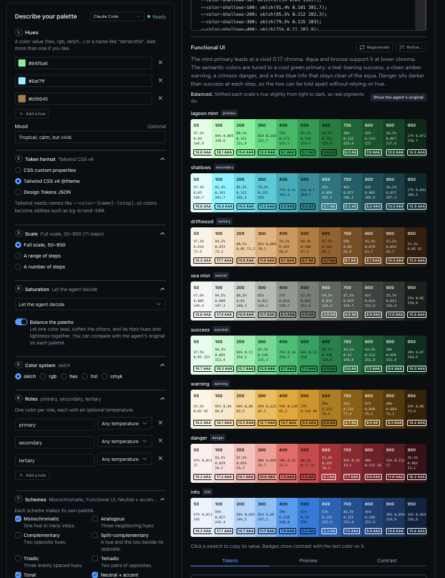

# Palletter: Color Palette Generator for the Web


Palletter is a web application for generating color palettes for use on the web. Choose a base color, the relationship you want the colors to have, and any other rules or constraints you want on the palette. Palletter will give you a set of tokens along with their color values that you can copy and paste into your CSS.

> **Status:** in development. The generator works end to end: fill in the form, and your agent creates palettes you can copy. Saving and sharing palettes is next. See [PLAN.md](./PLAN.md) for the plan and milestones.




## How it works

Palletter turns your input into a prompt and sends it over the [Agent Client Protocol (ACP)](https://agentclientprotocol.com) to your connected model. The model chooses the colors by following the Palletter skills and its own training, and returns them as data. Palletter turns them into tokens.

Palletter doesn't take the model's output on faith. Before you see a palette, Palletter:

1. **Validates** the response against a strict schema. If the response is malformed, it asks the model to fix it.
2. **Balances** the palette (see [Balance](#balance)), so one color leads and each scale shifts hue naturally from light to dark.
3. **Converts** each color into the color system you picked, so the values are exact and consistent instead of approximated by the model.
4. **Checks** contrast between the colors in the palette and flags pairs that won't meet WCAG AA for text.
5. **Formats** the tokens in your chosen format, ready to paste.

```
┌──────────┐  palette request  ┌──────────────────┐   prompt + skills   ┌──────────────┐
│ Browser  │ ────────────────► │ Palletter server │ ──────── ACP ─────► │  Your agent  │
│   (UI)   │ ◄──── stream ──── │  (Astro / Bun)   │ ◄──── response ──── │   / model    │
└──────────┘  tokens + preview └──────────────────┘                     └──────────────┘
                                validate · convert · contrast · format
```

Because ACP agents run as local processes, Palletter runs on your machine and uses the agent you already have installed and signed in. Palletter doesn't store API keys. Claude Code uses its own login. A MiniMax key stays in your local `.env`, and Palletter passes it only to the agent process it starts.

## Workflow

The basic workflow can be as objective or subjective as you want. Your model will do all the heavy lifting. All but step 1 are optional, though you will get better results with more information provided.

1. **Hues.** Choose a single hue or a set of hues you want included in your palette. You can enter a color value, use the picker, or name a color (`"terracotta"`). You can also add a mood or feeling you want the palette to convey (`"calm, trustworthy, a little playful"`).
2. **Token format.** Choose the type of tokens you want, e.g. Tailwind CSS, or plain custom properties such as `--brand-[color]` or `--color-[mood]`.
3. **Scale.** Choose between a full value set (e.g. `--color-50` to `--color-950`), or a specific range of values (e.g. `--color-100` to `--color-300`).
4. **Saturation.** Choose saturation, e.g. vivid, muted, pure, pastel, or earthy.
5. **Color system.** Choose a color system, e.g. oklch, hex, rgb, hsl, or cmyk.
6. **Relationships.** Choose the roles you need, e.g. primary, secondary, and tertiary, and the temperature you want for each (warm, cool, or neutral).
7. **Schemes.** Finally, choose the schemes you need. This decides the actual outputs you get. The default, **From my colors**, keeps the colors you entered and adds what a website needs around them. You can also pick wheel-based schemes such as analogous or triadic, or other character schemes such as Functional UI.
8. Hit **Create**.

Each scheme you select produces its own palette, so you can compare them side by side and copy the one you like.

## Color Systems

The supported systems are:

| System | Example | Notes |
| ------ | ------- | ----- |
| oklch  | `oklch(62.8% 0.177 259.8)` | Default. Perceptually uniform, so scales step evenly in lightness. Supports wide-gamut (P3) colors. |
| rgb    | `rgb(37 99 235)` | Modern space-separated syntax. |
| hex    | `#2563eb` | Most widely supported. |
| hsl    | `hsl(221 83% 53%)` | Easy to adjust by hand. |
| cmyk   | `cmyk(84% 58% 0% 8%)` | For reference and print handoff. Browsers don't support CMYK in CSS yet, so Palletter also outputs a web-safe value next to each CMYK token. |

When a color from the model is outside the sRGB gamut and you choose an sRGB-based system (rgb, hex, hsl), Palletter maps it into gamut and marks it so you know the value was adjusted.

## Palette Types

A palette type (or scheme) describes how the hues in the palette relate to each other on the color wheel. Pick one or more.

| Scheme | Hues | What it's good for |
| ------ | ---- | ------------------ |
| **Monochromatic** | 1 hue, many lightness and chroma steps | Calm, cohesive interfaces. The safest choice for UI. |
| **Analogous** | 3 neighboring hues (about 30° apart) | Harmonious, low-tension palettes, common in nature. |
| **Complementary** | 2 opposite hues (180°) | High contrast. A strong accent against a base color. |
| **Split-complementary** | Base plus the 2 hues next to its complement (about 150° and 210°) | Contrast with less tension than complementary. |
| **Triadic** | 3 evenly spaced hues (120°) | Vibrant, balanced palettes. Usually one hue dominates. |
| **Tetradic** | 4 hues in two complementary pairs (rectangle or square) | Rich palettes with many options. Hardest to balance. |
| **Tonal** | 3 close hues (about 15° apart) that differ in depth and softness | A more refined take on analogous. |

Some palettes are better described by what each color does than by angles on the wheel. Palletter doesn't check these against reference angles:

| Scheme | Colors | What it's good for |
| ------ | ------ | ------------------ |
| **From my colors** (default) | Every color you entered, a neutral tinted with the first, and one more supporting color if you entered fewer than three | Turning colors you like into a palette for a website. Your colors stay exactly as you entered them, and the first one leads. |
| **Neutral + accent** | A brand color, a tinted neutral scale, and an optional accent | What most products ship. Neutrals carry the screen and the brand color stands out. |
| **Functional UI** | A brand color, a neutral, and success, warning, danger, and info | Application UI. The status colors still read as green, amber, red, and blue, but are tuned to your brand. |
| **Sourced** | 3 to 5 colors drawn from a scene, material, or style | Palettes with a story, such as "desert dusk" or "Scandinavian interior". Name the source in the mood. |

The angles are a starting point. The Palletter skills tell the model to adjust hues, lightness, and chroma so the result looks good, rather than placing colors on exact angles. Palletter warns when a palette's hues stray more than 47° from the scheme: 35° of leeway for the model, plus up to 12° from Palletter's own common cast.

## Balance

A palette where every color is equally saturated looks harsh, whatever the scheme. Real designs give each color a job, so Palletter has the model give every color a role, and then balances the palette itself:

- **Chroma hierarchy.** The primary color leads at full chroma. Supporting colors (secondary, tertiary, and other roles) peak at no more than 70% of the primary's chroma. Accents stay bright, because they're used in small doses, and neutrals stay quiet.
- **Hue drift.** Each scale shifts hue slightly from light to dark, as real pigments do. Dark steps move toward blue-violet (yellows and ambers move toward orange and brown instead), and light steps move a little the other way, up to about 7° and 5°.
- **Common cast.** Supporting and accent hues are pulled a tenth of the way toward the primary's hue, up to 12°, like one light falling on a whole scene. Even triadic and tetradic palettes look related.
- **Lightness band.** The middle steps (300–700) of supporting and accent colors move toward the primary's lightness, so no color looks heavier than the others. Yellows, ambers, and limes are allowed to sit lighter, and a step never moves if that would make its text contrast worse.

Your exact colors are never changed, and a color that contains one isn't capped, pulled, or moved.

Each balanced palette says what Palletter changed, and **Show the agent's original** switches the swatches and tokens to the palette exactly as the agent made it, so you can compare and copy either one. To skip balancing altogether, turn off **Balance the palette** under Saturation. With **Pure** saturation, supporting colors aren't capped either. Colors that fit in sRGB still fit after balancing.

## Saturation

| Option | Description |
| ------ | ----------- |
| Vivid  | High chroma. Bold and energetic. |
| Pure   | The most saturated version of each hue that still works on screen. |
| Muted  | Reduced chroma. Sophisticated and calm. |
| Pastel | High lightness, low chroma. Soft and friendly. |
| Earthy | Low chroma, shifted toward warm. Natural and grounded. |
| Custom | Describe what you want in your own words. |

## Token Formats

Palletter can output tokens as:

- **CSS custom properties.** You choose the naming pattern, e.g. `--brand-[color]-[step]`, `--color-[role]-[step]`, or `--color-[mood]-[step]`.
- **Tailwind CSS v4.** An `@theme` block, so the colors are available as utilities such as `bg-brand-500`. Tailwind needs names in the form `--color-[name]-[step]`, so the naming pattern doesn't apply.
- **Design Tokens JSON.** In the [W3C Design Tokens Community Group](https://www.designtokens.org) format, for tools such as Style Dictionary and Figma plugins.

### Example output

A monochromatic `brand` palette in oklch, as CSS custom properties, with the range `100` to `300`:

```css
:root {
  --brand-100: oklch(93.2% 0.032 255.6);
  --brand-200: oklch(88.2% 0.059 254.1);
  --brand-300: oklch(80.9% 0.105 251.8);
}
```

The same palette as a Tailwind v4 theme:

```css
@theme {
  --color-brand-100: oklch(93.2% 0.032 255.6);
  --color-brand-200: oklch(88.2% 0.059 254.1);
  --color-brand-300: oklch(80.9% 0.105 251.8);
}
```

## Scales

| Option | Steps |
| ------ | ----- |
| Full   | `50, 100, 200, 300, 400, 500, 600, 700, 800, 900, 950` |
| Range  | Any contiguous range of the full scale, e.g. `100` to `300` |
| Count  | A specific number of evenly spaced steps, e.g. 5 gives `50, 300, 500, 700, 950` |

Step `500` is anchored to your base hue unless you say otherwise. Lower numbers are lighter and higher numbers are darker, so the same token works the way you'd expect from Tailwind.

## Getting Started

### Requirements

- [Bun](https://bun.sh) 1.4.4 or later (Palletter's server runs on Bun)
- [Node.js](https://nodejs.org) 22 or later (used by Astro's build tooling)
- One of these agents:
  - **Claude Code**, signed in on your machine (run `claude` once and log in), or an `ANTHROPIC_API_KEY`
  - **MiniMax**, with a MiniMax API key
  - Any other agent that speaks ACP

### Install and run

```bash
bun install
```

```bash
bun run dev
```

Then open <http://localhost:4321>.

### Connect your agent

Palletter talks to agents over ACP. It comes with the [Claude Code ACP adapter](https://github.com/agentclientprotocol/claude-agent-acp), installed by `bun install`, and has three agent settings. Put your settings in a `.env` file at the project root. [`.env.example`](./.env.example) lists them all.

**Claude Code** is the default. If you're signed in to Claude Code, there's nothing to set up.

**MiniMax** runs through the same Claude Code adapter, pointed at [MiniMax's Anthropic-compatible API](https://platform.minimax.io/docs/api-reference/text-anthropic-api). Add your key:

```bash
MINIMAX_API_KEY=your-minimax-key
```

The model is `MiniMax-M3.1-Flash` unless you set `PALLETTER_MINIMAX_MODEL`. In mainland China, also set `PALLETTER_MINIMAX_BASE_URL=https://api.minimax.cn/anthropic`.

**Any other ACP agent** can be started with a command:

```bash
PALLETTER_AGENT_COMMAND="gemini --experimental-acp"
```

Check your agent's documentation for its ACP command.

With more than one agent set up, `PALLETTER_AGENT` (`claude`, `minimax`, or `custom`) picks the default, and each request can name its own.

#### Choosing a model

When the agent offers a choice of models over ACP, a **Model** picker appears next to the agent picker, listing exactly the models that agent offers. Claude Code lists the models your account can use, starting with **Default (recommended)**, which uses Claude Code's own default model. That depends on your account, and the picker shows which model it is.

Palletter sends a model only when you pick something other than the default, so Claude Code's default stays in charge otherwise. MiniMax has no picker: it always uses `PALLETTER_MINIMAX_MODEL`.

#### What the agent can do

Palletter starts the agent the first time you create a palette and keeps it running until the server stops. Each palette request gets its own session, in an empty temporary folder.

The agent is given only the palette request and the Palletter skills:

- Palletter doesn't offer the agent any access to your files or terminal, and it refuses every permission request.
- For Claude Code and MiniMax, Claude Code's built-in tools are switched off. Your Claude settings, `CLAUDE.md` files, and hooks aren't loaded.

#### Settings

| Variable | Default | What it does |
| -------- | ------- | ------------ |
| `PALLETTER_AGENT` | `claude`, or `custom` if `PALLETTER_AGENT_COMMAND` is set | The default agent |
| `MINIMAX_API_KEY` | | Turns on the MiniMax agent |
| `PALLETTER_MINIMAX_MODEL` | `MiniMax-M3.1-Flash` | The MiniMax model |
| `PALLETTER_MINIMAX_BASE_URL` | `https://api.minimax.io/anthropic` | The MiniMax API address |
| `PALLETTER_AGENT_COMMAND` | | The command for a custom ACP agent |
| `PALLETTER_AGENT_TIMEOUT_MS` | `180000` | How long to wait for the agent's reply |

### API

The UI uses two endpoints, which you can also call directly.

`GET /api/agent` lists the agents and which one is the default. Add `?check=claude` (or another agent) to start it and check that it answers. If the agent offers a choice of models, the check also returns `models`: the one new sessions use (`current`) and every choice (`choices`, each with a `value` and `name`).

`POST /api/palettes` takes a palette request as JSON, with an optional `agent` and an optional `model` (a `value` from that agent's `choices`). It responds with [server-sent events](https://developer.mozilla.org/docs/Web/API/Server-sent_events), in this order:

1. `status` events as the agent starts, thinks, and writes
2. One `palette` event per scheme, with the converted colors, the formatted tokens, the balanced oklch palette (`source`), the agent's own palette when balancing changed it (`original`), and what balancing changed (`notes`)
3. `session`, with an id you can use to refine the palettes
4. `done`, or `error` with a `code` and a message

`POST /api/palettes/refine` takes `{ "sessionId", "scheme", "note" }` and streams the same events for that one scheme. Without a note, the agent makes a different version. Sessions close 30 minutes after their last use; a closed session returns 404 with `code: "session_expired"`.

```bash
curl -N localhost:4321/api/palettes -H 'content-type: application/json' \
  -d '{"hues":[{"value":"#2563eb"}],"schemes":["complementary"],"colorSystem":"hex"}'
```

If the agent's reply has problems, Palletter asks it to fix them once before reporting an error.

## Development

| Command | Action |
| ------- | ------ |
| `bun install` | Install dependencies |
| `bun run dev` | Start the dev server at `localhost:4321` |
| `bun run build` | Build the production server to `./dist/` |
| `bun run start` | Run the built server with Bun |
| `bun run preview` | Preview the build locally |
| `bun run check` | Typecheck Astro, Svelte, and TypeScript files |
| `bun run test` | Run the unit tests (Vitest) |
| `bun run test:e2e` | Run the end-to-end tests (Playwright) |
| `bun run prompt` | Print the prompt for a request, or check a model's reply (see `scripts/prompt.ts`) |
| `bun run icons` | Rebuild the bundled icon set after adding an icon (see `scripts/icons.ts`) |

The end-to-end tests need a Chromium for Playwright. Run `bunx playwright install chromium` once, or set `PW_CHROMIUM_PATH` to a Chromium that's already installed.

### Trying the prompt without the app

You can test the Palletter skills with any chat model:

```bash
bun run prompt '{"hues":[{"value":"#2563eb"}],"schemes":["analogous"]}' > prompt.txt
```

Paste `prompt.txt` into the model, save its whole reply as `reply.txt`, then check it:

```bash
bun run prompt '{"hues":[{"value":"#2563eb"}],"schemes":["analogous"]}' reply.txt
```

If the reply is good, this prints the tokens. If not, it lists the problems and prints a repair prompt to send back to the model.

### UI components

The UI uses [SV5UI](https://sv5ui.vercel.app) components with Tailwind CSS 4, inside Astro's Svelte islands. Components use SV5UI's default styles: Palletter doesn't set their `variant`, `color`, `size`, or `ui` slot classes, except an Alert's color for errors and warnings and one functional fix on the hue input. Palletter's own classes only lay out the page. Theme colors come from SV5UI's tokens (`bg-surface`, `text-on-surface`, `border-outline-variant`, `bg-primary`, and so on); see [SV5UI theming](https://sv5ui.vercel.app/docs/theming) to change them in `src/styles/global.css`.

SV5UI is built for SvelteKit, so Palletter adds two small pieces to run it on Astro:

- `src/lib/shims/app-state.ts` stands in for SvelteKit's `$app/state`, which a few SV5UI components read. It's wired up as a Vite alias in `astro.config.mjs`.
- A script in `src/layouts/Layout.astro` applies the saved light or dark mode before the page paints.

Icons are bundled rather than fetched from the Iconify API, so the app works offline and makes no third-party requests. To use a new [Lucide](https://lucide.dev/icons) icon, add its name to `scripts/icons.ts` and run `bun run icons`. A unit test fails if a `lucide:` icon is used but not bundled.

### Project structure

```
/
├── e2e/                 Playwright end-to-end tests
├── public/              Static assets
├── scripts/             Developer scripts
├── skills/              The Palletter skills the agent follows
├── src/
│   ├── components/      Astro components and UI islands
│   ├── layouts/
│   ├── lib/
│   │   ├── acp/         ACP client and agent process management
│   │   ├── color/       Conversion, gamut mapping, and contrast
│   │   ├── format/      Token formatters (CSS, Tailwind, JSON) and naming
│   │   ├── palette/     Turns a model palette into values, flags, and contrast
│   │   └── prompt/      Prompt builder and response schema
│   ├── pages/
│   │   ├── api/         Server endpoints
│   │   └── index.astro  The generator
│   └── styles/          Tailwind CSS 4 and the SV5UI theme
├── test/                Shared test fixtures
└── PLAN.md              Development plan
```

Full Astro documentation: <https://docs.astro.build>.

## Roadmap

See [PLAN.md](./PLAN.md).
